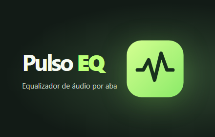

# Pulso EQ

Extensão para Chrome 116 ou mais recente que equaliza e amplifica o áudio de cada aba.

## Instalação local

1. Abra `chrome://extensions` e ative o **Modo do desenvolvedor**.
2. Clique em **Carregar sem compactação** e selecione a pasta `extension` deste projeto.
3. Abra uma página com áudio, clique no ícone do Pulso EQ e escolha **Ativar nesta aba**.

## Controles

- Sete bandas de 60 Hz a 12 kHz, ajustáveis de −12 a +12 dB.
- Volume de 0% a 400%. Aumente aos poucos, principalmente com fones.
- Cinco presets de fábrica: Plano, Mais grave, Voz clara, Brilho e Noite.
- Presets pessoais guardam o equalizador e o volume. Para substituir um preset, salve novamente com o mesmo nome.
- **Restaurar** zera a equalização e volta o volume a 100%. **Desativar nesta aba** devolve a reprodução ao navegador.

Os ajustes ficam ativos após fechar o painel. Cada aba tem uma sessão independente. A captura pode interferir no modo de tela cheia de alguns players. O processamento ocorre localmente, conforme a [política de privacidade](PRIVACIDADE.md).

## Atualizações

Cada mudança publicada entra neste repositório. Para lançar uma versão, atualize `extension/manifest.json` e `CHANGELOG.md`, faça o push e envie uma tag que corresponda à versão, como `v1.0.0`. O GitHub Actions gera o ZIP e anexa o pacote à release. O envio à Chrome Web Store é feito pelo painel do desenvolvedor.

No PowerShell, gere o ZIP localmente com `Compress-Archive -Path extension/* -DestinationPath pulso-eq.zip -Force`.
